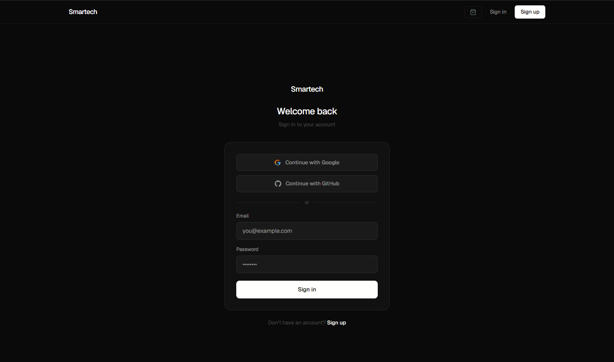

<div align="center">

[English](README.md) | [Español](README.es.md)

# Smartech

**A full-stack e-commerce application built with Next.js, Supabase and Stripe.**

A portfolio project demonstrating production-grade patterns: real-time stock management, role-based access control, idempotent payment webhooks and cross-device cart sync.

[](https://nextjs.org/)
[](https://react.dev/)
[](https://www.typescriptlang.org/)
[](https://tailwindcss.com/)
[](https://supabase.com/)
[](https://stripe.com/)
[](https://vercel.com/)

**Live demo:** [smartech-one.vercel.app](https://smartech-one.vercel.app)

</div>

---

## Table of contents

- [Overview](#overview)
- [Preview](#preview)
- [Features](#features)
- [Tech stack](#tech-stack)
- [Architecture decisions](#architecture-decisions)
- [Getting started](#getting-started)
- [Environment variables](#environment-variables)
- [Database](#database)
- [Project structure](#project-structure)
- [Deployment](#deployment)
- [Roadmap](#roadmap)
- [Author](#author)

---

## Overview

Smartech is a complete storefront and admin panel where customers can browse a catalog, manage a persistent cart, pay with Stripe and track their orders, while administrators manage products, orders and users.

It exists as a **portfolio project** and focuses on the parts of an e-commerce that are easy to get wrong:

- **Overselling** → stock is validated before checkout and decremented atomically inside the payment webhook, guarded against concurrent purchases.
- **Duplicate payments** → the webhook is idempotent: a unique constraint on `stripe_session_id` makes repeated Stripe events safe to ignore.
- **Authorization** → roles live in the database and are enforced with Row Level Security, not just in the UI.
- **Cart continuity** → the cart is kept locally for guests and synced to the database for authenticated users across devices.

---

## Preview

> 

---

## Features

### Storefront
- Product catalog with sidebar filters: search, category, sorting and price range.
- Responsive design: sidebar on desktop, bottom drawer on mobile.
- Home page composed of Hero, featured products, category showcase, promo banner, best sellers and testimonials.
- Product detail pages with image zoom panel, stock status and related products.
- Image fallback component and skeleton loading states.
- Accessible by default: skip-to-content link, labeled inputs, `sizes` on fill images and `prefers-reduced-motion` support.

### Authentication
- Email/password registration and login.
- OAuth with Google and GitHub.
- Protected routes via Next.js middleware.
- Session management with Supabase SSR and an OAuth callback route.

### Cart & checkout
- Persistent cart with Zustand and `localStorage` (`cart-storage`).
- Cart drawer with smooth animations, mounted at the root layout.
- Cross-device cart sync to the `cart_items` table for authenticated users; guest cart stays local.
- Merge on login: guest items and server items are combined, capped to available stock.
- Real payments through Stripe Checkout.
- Stock validation before checkout to prevent overselling.
- Idempotent webhook handling — duplicate Stripe events are safely ignored.
- Atomic stock decrement via a PostgreSQL function after successful payment.

### User dashboard
- Order history with status tracking and per-order detail pages.
- Wishlist management.
- Profile editing.

### Reviews
- Star ratings with optional comments.
- Only verified buyers (users with a paid order for the product) can submit or edit a review.

### Admin panel
- Product CRUD with image uploads to Supabase Storage.
- Client-side search and pagination on product, order and user tables.
- Order management with inline status updates.
- User overview with role display and last sign-in information.

---

## Tech stack

| Technology | Purpose |
|---|---|
| **Next.js 16** (App Router) | Framework — Server Components, Server Actions, route handlers |
| **React 19** | UI runtime |
| **TypeScript 5** (strict) | Type safety across the codebase |
| **Tailwind CSS 4** | Styling — dark design system driven by CSS variables |
| **Supabase** | PostgreSQL database, authentication, storage and RLS policies |
| **Stripe** | Payment processing and webhook handling |
| **Zustand** | Client-side state management for the cart and UI |
| **Sonner** | Toast notifications |
| **Lucide React** | Icon library |
| **Vercel** | Deployment and edge functions |

---

## Architecture decisions

The most relevant decisions are documented here because they explain *why* the code is structured the way it is.

### Role-based access control

User roles (`customer` / `admin`) are stored in the `profiles` table and enforced at the database level through Supabase Row Level Security policies. A `security definer` PostgreSQL function handles role checks without triggering infinite recursion in RLS policies.

The middleware only verifies that a session exists. Role verification happens inside each protected page through a `requireAdmin()` server function — this avoids a database query on every single request.

### Idempotent webhook

Stripe can deliver the same webhook event multiple times. The handler checks for a `23505` duplicate key error on the `stripe_session_id` unique constraint instead of using a pre-check `SELECT`. This removes the race condition that would occur if multiple webhook calls arrived simultaneously.

### Atomic stock management

Stock decrements run as a single atomic operation through a PostgreSQL function:

```sql
update products
set stock = stock - quantity
where id = product_id
and stock >= quantity;
```

The `and stock >= quantity` guard prevents negative stock even under concurrent purchases. If stock is insufficient, the function raises an exception that is caught and logged without failing the webhook — the payment is already confirmed and cannot be reversed.

### Supabase SSR — three clients

Three separate clients are used and must be imported explicitly:

| File | When to use |
|---|---|
| `src/lib/supabase/server.ts` | Server Components and Server Actions |
| `src/lib/supabase/client.ts` | Browser Client Components |
| `src/lib/supabase/admin.ts` | Webhook handler and server-side admin operations (`service_role` key) |

This split is required by the Next.js App Router because cookie handling differs between server and client contexts.

### Cart architecture

The cart drawer is mounted at the root layout level rather than inside the Navbar. This prevents `position: fixed` elements from losing their positioning context when a parent has a `transform` or `overflow` applied — a common source of z-index and layout bugs.

Cart state lives in a Zustand store persisted to `localStorage`. A `CartSync` component reconciles the local cart with the server for authenticated users.

---

## Getting started

### Prerequisites

- Node.js 18+
- A [Supabase](https://supabase.com) account
- A [Stripe](https://stripe.com) account
- The [Stripe CLI](https://stripe.com/docs/stripe-cli) for local webhook testing

### 1. Clone the repository

```bash
git clone https://github.com/patorodriguez12/e-commerce.git
cd e-commerce
```

### 2. Install dependencies

```bash
npm install
```

### 3. Set up Supabase

Create a new Supabase project and provision the database:

1. Create the tables: `categories`, `products`, `profiles`, `orders`, `order_items`, `wishlists`, `reviews` and `cart_items`.
2. Enable Row Level Security on every table.
3. Create the `get_user_role` `security definer` function.
4. Create the RLS policies for each table.
5. Create the `decrement_stock` and `increment_sales_count` functions.
6. Create the `on_auth_user_created` trigger to populate `profiles`.

> [!WARNING]
> The SQL schema is **not versioned in this repository** yet — it must be provisioned manually in the Supabase SQL Editor. The cart sync, the webhook and the review gating all depend on it. See [Database](#database) for the required objects.

### 4. Set up environment variables

Create a `.env.local` file in the root:

```bash
# Supabase
NEXT_PUBLIC_SUPABASE_URL=https://your-project.supabase.co
NEXT_PUBLIC_SUPABASE_ANON_KEY=your-anon-key
SUPABASE_SERVICE_ROLE_KEY=your-service-role-key

# Stripe
NEXT_PUBLIC_STRIPE_PUBLISHABLE_KEY=pk_test_...
STRIPE_SECRET_KEY=sk_test_...
STRIPE_WEBHOOK_SECRET=whsec_...

# App
NEXT_PUBLIC_APP_URL=http://localhost:3000
```

### 5. Set up OAuth (optional)

- **Google:** create a project in the [Google Cloud Console](https://console.cloud.google.com), configure an OAuth consent screen and create OAuth credentials. Add `https://your-project.supabase.co/auth/v1/callback` as an authorized redirect URI.
- **GitHub:** create an OAuth App in [GitHub Developer Settings](https://github.com/settings/developers). Set the callback URL to `https://your-project.supabase.co/auth/v1/callback`.

Enable both providers in Supabase under Authentication → Providers.

### 6. Run the development server

```bash
# Terminal 1 — Next.js
npm run dev

# Terminal 2 — Stripe webhook forwarding
stripe listen --forward-to localhost:3000/api/stripe/webhook
```

Copy the webhook signing secret from the Stripe CLI output into `STRIPE_WEBHOOK_SECRET`, then open [http://localhost:3000](http://localhost:3000).

### 7. Create an admin user

Register a new account, then run this SQL in the Supabase SQL Editor:

```sql
update profiles
set role = 'admin'
where id = (select id from auth.users where email = 'your@email.com');
```

Access the admin panel at `/admin`.

### 8. Test payments

Use Stripe's test card:

```text
Number:  4242 4242 4242 4242
Expiry:  Any future date
CVC:     Any 3 digits
```

### Available scripts

```bash
npm run dev      # Development server
npm run build    # Production build
npm run start    # Production server
npm run lint     # ESLint (flat config)
```

> [!NOTE]
> There are no test, typecheck or format scripts configured.

---

## Environment variables

| Variable | Required | Description |
|---|---|---|
| `NEXT_PUBLIC_SUPABASE_URL` | Yes | Supabase project URL |
| `NEXT_PUBLIC_SUPABASE_ANON_KEY` | Yes | Supabase anonymous key (public) |
| `SUPABASE_SERVICE_ROLE_KEY` | Yes | Supabase service role key (server only) |
| `NEXT_PUBLIC_STRIPE_PUBLISHABLE_KEY` | Yes | Stripe publishable key (public) |
| `STRIPE_SECRET_KEY` | Yes | Stripe secret key (server only) |
| `STRIPE_WEBHOOK_SECRET` | Yes | Stripe webhook signing secret |
| `NEXT_PUBLIC_APP_URL` | Yes | Base URL of the app (no trailing slash) |

> [!IMPORTANT]
> `SUPABASE_SERVICE_ROLE_KEY` and `STRIPE_SECRET_KEY` bypass security layers. Keep them server-side, never prefix them with `NEXT_PUBLIC_` and never commit them.

---

## Database

### Main tables

| Table | Description |
|---|---|
| `categories` | Product categories |
| `products` | Catalog with price (cents), stock and `sales_count` |
| `profiles` | User profiles with `role` (`customer` / `admin`) |
| `orders` | Order headers, linked to a `stripe_session_id` |
| `order_items` | Line items per order |
| `wishlists` | Saved products per user |
| `reviews` | Ratings and comments, one per user/product |
| `cart_items` | Server-side cart for cross-device sync |

### Functions and triggers

- `decrement_stock(product_id, quantity)` — atomic, guarded stock decrement.
- `increment_sales_count(product_id, quantity)` — feeds the best-sellers ranking.
- `get_user_role()` — `security definer` role lookup used by RLS policies.
- `on_auth_user_created` — creates a `profiles` row when a user signs up.

> [!NOTE]
> Prices are stored as **integers in cents**. `formatPrice(n)` divides by 100 and formats as USD.

---

## Project structure

```text
src/
├── app/
│   ├── (main)/
│   │   ├── (auth)/            # Login and register pages
│   │   ├── (store)/           # Home, catalog and product detail
│   │   ├── auth/callback/     # OAuth code exchange
│   │   ├── checkout/          # Checkout and success pages
│   │   ├── dashboard/         # User dashboard (orders, wishlist, profile)
│   │   └── layout.tsx         # Navbar + Footer wrapper
│   ├── admin/                 # Admin panel (role-gated, own layout)
│   └── api/
│       ├── checkout/session/  # Creates the Stripe Checkout Session
│       └── stripe/webhook/    # Handles payment events
├── components/
│   ├── admin/                 # Tables, forms, sidebar, search, pagination
│   ├── auth/                  # OAuth buttons
│   ├── cart/                  # Cart drawer, items, sync
│   ├── dashboard/             # Profile form and nav
│   ├── home/                  # Hero, featured, categories, testimonials
│   ├── layout/                # Navbar, footer, user menu
│   ├── products/              # Cards, filters, zoom, reviews
│   └── ui/                    # Shared UI (password input, skeleton)
├── lib/
│   ├── hooks/                 # useFilters
│   ├── queries/               # Admin order queries
│   ├── store/                 # Zustand stores (cart, drawer)
│   ├── supabase/              # Clients, actions, auth, storage
│   ├── stripe/                # Stripe client
│   └── utils/                 # formatPrice
└── types/                     # Shared TypeScript types
```

---

## Deployment

The application is intended for **Vercel**:

1. Import the repository into Vercel.
2. Add all environment variables in the Vercel project settings.
3. Set the Stripe webhook endpoint to `https://your-domain/api/stripe/webhook` and update `STRIPE_WEBHOOK_SECRET` with the production signing secret.
4. Deploy.

---

## Roadmap

- [ ] Version the SQL schema and RLS policies in the repository.
- [ ] Discount codes via Stripe Coupons.
- [ ] Order status email notifications.
- [ ] Admin analytics dashboard with revenue charts.
- [ ] Product image gallery (multiple images per product).
- [ ] Automated tests for the checkout and webhook flows.

---

## Author

**Pato Rodríguez**

- GitHub: [@patorodriguez12](https://github.com/patorodriguez12)
- Email: pato_rodriguez12@outlook.com
